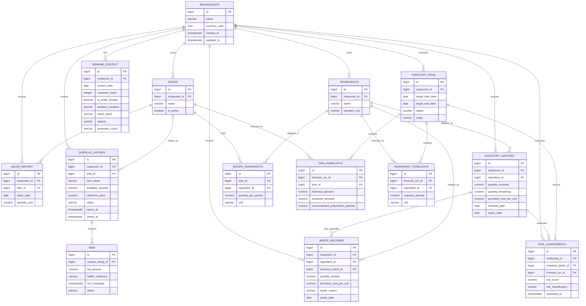

# Database Design

## 1. Purpose and scope

This document defines the proposed PostgreSQL schema for **A Proactive AI-Based
Food Waste Prevention System for Restaurants**. It is a design specification
only. It does not create a database, SQLAlchemy models, Alembic migrations,
connections, APIs, machine-learning models, or business services.

The design supports the three research components already represented in the
frontend:

1. Smart Demand Forecasting & Quantity Recommendation.
2. Expiry-Aware Inventory & Waste Risk Detection, including Cost and Savings.
3. Real-Time Surplus Pricing & Bidding.

The planned implementation stack is PostgreSQL, SQLAlchemy, Alembic, and
FastAPI. Amounts and quantities that may require decimal precision use
`NUMERIC`, never floating-point types. Timestamps use `TIMESTAMPTZ`.

## 2. Design objectives and assumptions

- Every operational record belongs to a `restaurant`, allowing future
  multi-restaurant support without introducing user or authentication tables.
- All database entities use generated `BIGINT` identity primary keys. A
  different key type would require a documented technical requirement.
- A restaurant reports in one currency, defaulting to `LKR`; currency is stored
  explicitly so formatting is not inferred from application settings.
- Units are validated against a controlled vocabulary and normalized through a
  centralized conversion approach. Compatible mass units (`g` and `kg`) and
  volume units (`mL` and `L`) may be converted. Mass-to-volume conversion is
  not permitted without an ingredient-specific density or conversion factor.
  Individual units remain separate from both mass and volume.
- Forecast and risk outputs are snapshots of a run. Source sales, inventory,
  recipes, and waste records remain authoritative.
- Current inventory is represented by batches, not a single mutable ingredient
  total. Remaining stock is the quantity still available from that batch.
- Waste records represent confirmed waste only. Stock that may be wasted is
  inventory value at risk, not recorded waste.
- Bidder identity is intentionally minimal. Authentication, payments, customer
  profiles, and delivery workflows are out of scope.
- The current frontend values are illustrative. They are not historical
  production data and do not constitute trained-model output or validated
  savings evidence.

## 3. Core schema

The following tables are required for the first database-backed
implementation unless a later approved scope change removes a feature.

### 3.1 `restaurants`

Stores restaurant-level configuration and ownership boundaries.

| Column | PostgreSQL type | Null? | Key/default | Description |
|---|---|---:|---|---|
| `id` | `BIGINT` | No | PK, generated identity | Restaurant identifier |
| `name` | `VARCHAR(200)` | No | — | Display name |
| `currency_code` | `CHAR(3)` | No | `LKR` | ISO-style reporting currency code |
| `created_at` | `TIMESTAMPTZ` | No | `now()` | Creation time |
| `updated_at` | `TIMESTAMPTZ` | No | `now()` | Last update time |

Constraints:

- `name` must not be blank.
- `currency_code` must be an uppercase three-letter code; the initial service
  should accept `LKR`.
- `UNIQUE (name)` is optional because two restaurant branches may share a
  trading name. A future business identifier can be added if required.

### 3.2 `dishes`

Stores dishes sold or prepared by a restaurant.

| Column | PostgreSQL type | Null? | Key/default | Description |
|---|---|---:|---|---|
| `id` | `BIGINT` | No | PK, generated identity | Dish identifier |
| `restaurant_id` | `BIGINT` | No | FK → `restaurants.id` | Owning restaurant |
| `name` | `VARCHAR(200)` | No | — | Dish name |
| `is_active` | `BOOLEAN` | No | `true` | Whether the dish is currently offered |
| `created_at` | `TIMESTAMPTZ` | No | `now()` | Creation time |
| `updated_at` | `TIMESTAMPTZ` | No | `now()` | Last update time |

Constraint: `UNIQUE (restaurant_id, name)`.

### 3.3 `ingredients`

Stores ingredients and their standard measurement unit.

| Column | PostgreSQL type | Null? | Key/default | Description |
|---|---|---:|---|---|
| `id` | `BIGINT` | No | PK, generated identity | Ingredient identifier |
| `restaurant_id` | `BIGINT` | No | FK → `restaurants.id` | Owning restaurant |
| `name` | `VARCHAR(200)` | No | — | Ingredient name |
| `standard_unit` | `VARCHAR(16)` | No | — | `kg`, `g`, `L`, `mL`, or `unit` |
| `created_at` | `TIMESTAMPTZ` | No | `now()` | Creation time |
| `updated_at` | `TIMESTAMPTZ` | No | `now()` | Last update time |

Constraints:

- `UNIQUE (restaurant_id, name)`.
- `standard_unit` must be in the initial controlled vocabulary:
  `kg`, `g`, `L`, `mL`, `unit`.
- Conversion factors are centralized in the planned unit-normalization service
  or a later approved reference table, rather than duplicated in recipe,
  inventory, waste, and forecast rows. The initial implementation must support
  `g` ↔ `kg` and `mL` ↔ `L`, while rejecting mass-to-volume and
  individual-to-mass/volume conversions unless an ingredient-specific factor
  is explicitly configured.

### 3.4 `recipe_ingredients`

Junction table for the many-to-many relationship between dishes and
ingredients. `quantity_per_portion` is the amount of the ingredient required
for one portion of the dish.

| Column | PostgreSQL type | Null? | Key/default | Description |
|---|---|---:|---|---|
| `id` | `BIGINT` | No | PK, generated identity | Recipe-line identifier |
| `dish_id` | `BIGINT` | No | FK → `dishes.id` | Dish |
| `ingredient_id` | `BIGINT` | No | FK → `ingredients.id` | Ingredient |
| `quantity_per_portion` | `NUMERIC(14,4)` | No | — | Required amount per portion |
| `unit` | `VARCHAR(16)` | No | — | Unit of this recipe quantity |

Constraints:

- `UNIQUE (dish_id, ingredient_id)`, unless a later recipe-version design
  explicitly allows multiple lines for one ingredient.
- `quantity_per_portion > 0`.
- `unit` must be compatible with the ingredient's `standard_unit`.
- The dish and ingredient must belong to the same restaurant. This is best
  enforced in the service layer or through a composite foreign-key design.

To avoid double-counting shared ingredients, the forecasting service groups
recipe lines by `ingredient_id` and compatible unit, then sums:

```text
consolidated ingredient quantity =
sum(dish preparation quantity × quantity_per_portion)
```

The same ingredient is therefore one consolidated requirement even when it is
used by several dishes.

### 3.5 `sales_history`

Stores historical POS sales used as demand-forecast input.

| Column | PostgreSQL type | Null? | Key/default | Description |
|---|---|---:|---|---|
| `id` | `BIGINT` | No | PK, generated identity | Sales-record identifier |
| `restaurant_id` | `BIGINT` | No | FK → `restaurants.id` | Restaurant |
| `dish_id` | `BIGINT` | No | FK → `dishes.id` | Dish sold |
| `sales_date` | `DATE` | No | — | Business date |
| `quantity_sold` | `NUMERIC(12,2)` | No | — | Portions sold |
| `source_reference` | `VARCHAR(200)` | Yes | — | Import/file/POS reference |
| `created_at` | `TIMESTAMPTZ` | No | `now()` | Import time |

Constraints:

- `quantity_sold >= 0`.
- `UNIQUE (restaurant_id, dish_id, sales_date, source_reference)` when a
  source reference exists; import idempotency should be handled by the
  ingestion service.
- The dish must belong to the same restaurant.
- No customer-identifying information is stored.

### 3.6 `demand_context`

Stores date-keyed forecasting inputs. One row represents the context known for
one restaurant and date.

| Column | PostgreSQL type | Null? | Key/default | Description |
|---|---|---:|---|---|
| `id` | `BIGINT` | No | PK, generated identity | Context identifier |
| `restaurant_id` | `BIGINT` | No | FK → `restaurants.id` | Restaurant |
| `context_date` | `DATE` | No | — | Date represented |
| `customer_count` | `INTEGER` | Yes | — | Daily covers/customers |
| `weather_condition` | `VARCHAR(120)` | Yes | — | Normalized or source label |
| `is_public_holiday` | `BOOLEAN` | No | `false` | Holiday flag |
| `holiday_name` | `VARCHAR(160)` | Yes | — | Optional holiday name |
| `event_name` | `VARCHAR(200)` | Yes | — | Local event, if relevant |
| `season` | `VARCHAR(80)` | Yes | — | Seasonality label |
| `promotion_name` | `VARCHAR(160)` | Yes | — | Promotion label |
| `created_at` | `TIMESTAMPTZ` | No | `now()` | Creation/import time |
| `updated_at` | `TIMESTAMPTZ` | No | `now()` | Last update time |

Constraints: `UNIQUE (restaurant_id, context_date)` and
`customer_count >= 0`. Day of week is derived from `context_date`, not stored
as a second authoritative value. Customer taste data is not included because
it is not a confirmed project input.

### 3.7 `forecast_runs`

Represents one forecast execution or demonstration forecast.

| Column | PostgreSQL type | Null? | Key/default | Description |
|---|---|---:|---|---|
| `id` | `BIGINT` | No | PK, generated identity | Forecast identifier |
| `restaurant_id` | `BIGINT` | No | FK → `restaurants.id` | Restaurant |
| `created_at` | `TIMESTAMPTZ` | No | `now()` | Forecast execution time |
| `target_start_date` | `DATE` | No | — | Start of target period |
| `target_end_date` | `DATE` | No | — | End of target period |
| `status` | `VARCHAR(20)` | No | `completed` | `draft`, `running`, `completed`, `failed` |
| `origin` | `VARCHAR(20)` | No | `demo` | `demo`, `service`, or `import` |

Constraints:

- `target_end_date >= target_start_date`.
- `status` and `origin` use controlled values.
- A failed run may have no result rows; it remains useful for operational
  diagnostics.

### 3.8 `dish_forecasts`

Stores dish-level forecast results as a snapshot of a forecast run.

| Column | PostgreSQL type | Null? | Key/default | Description |
|---|---|---:|---|---|
| `id` | `BIGINT` | No | PK, generated identity | Result identifier |
| `forecast_run_id` | `BIGINT` | No | FK → `forecast_runs.id` | Parent run |
| `dish_id` | `BIGINT` | No | FK → `dishes.id` | Dish |
| `historical_demand` | `NUMERIC(12,2)` | Yes | — | Reference demand used by run |
| `predicted_demand` | `NUMERIC(12,2)` | No | — | Predicted portions |
| `recommended_preparation_quantity` | `NUMERIC(12,2)` | No | — | Separate kitchen recommendation |
| `preparation_buffer_percent` | `NUMERIC(7,3)` | Yes | — | Optional run snapshot |

Constraints: `UNIQUE (forecast_run_id, dish_id)` and all demand quantities are
non-negative. Predicted demand and recommended preparation quantity must remain
separate because a preparation buffer is a planning decision, not a forecast.

### 3.9 `ingredient_forecasts`

Stores consolidated ingredient requirements for a forecast run.

| Column | PostgreSQL type | Null? | Key/default | Description |
|---|---|---:|---|---|
| `id` | `BIGINT` | No | PK, generated identity | Result identifier |
| `forecast_run_id` | `BIGINT` | No | FK → `forecast_runs.id` | Parent run |
| `ingredient_id` | `BIGINT` | No | FK → `ingredients.id` | Ingredient |
| `required_quantity` | `NUMERIC(14,4)` | No | — | Consolidated requirement |
| `unit` | `VARCHAR(16)` | No | — | Requirement unit |

Constraint: `UNIQUE (forecast_run_id, ingredient_id, unit)` and
`required_quantity >= 0`.

This table is a required forecast snapshot, not a replacement for recipes. It
is generated from `dish_forecasts` and `recipe_ingredients` in the same
transaction as the forecast run so it cannot drift from the run's dish-level
results. Persisting the snapshot allows historical recommendations to be
reviewed consistently even if recipes or source data later change.

### 3.10 `inventory_batches`

Represents physical stock received in a batch, including expiry and the
purchase cost needed for later waste calculations.

| Column | PostgreSQL type | Null? | Key/default | Description |
|---|---|---:|---|---|
| `id` | `BIGINT` | No | PK, generated identity | Batch identifier |
| `restaurant_id` | `BIGINT` | No | FK → `restaurants.id` | Restaurant |
| `ingredient_id` | `BIGINT` | No | FK → `ingredients.id` | Ingredient |
| `batch_reference` | `VARCHAR(120)` | Yes | — | Supplier or internal batch reference |
| `quantity_received` | `NUMERIC(14,4)` | No | — | Original quantity |
| `quantity_remaining` | `NUMERIC(14,4)` | No | — | Current available quantity |
| `unit` | `VARCHAR(16)` | No | — | Stock unit |
| `purchase_cost_per_unit` | `NUMERIC(14,4)` | No | — | Historical batch cost |
| `received_date` | `DATE` | No | — | Receipt date |
| `expiry_date` | `DATE` | No | — | Use-by/expiry date |
| `created_at` | `TIMESTAMPTZ` | No | `now()` | Creation time |
| `updated_at` | `TIMESTAMPTZ` | No | `now()` | Last stock update |

Constraints:

- `quantity_received > 0`.
- `0 <= quantity_remaining <= quantity_received`.
- `purchase_cost_per_unit >= 0`.
- `expiry_date >= received_date`.
- The batch unit must be compatible with the ingredient standard unit.
- `(restaurant_id, id)` relationships must not cross restaurant boundaries.

`quantity_received` is immutable receipt history. `quantity_remaining` changes
as stock is used or wasted. Inventory value at risk is calculated from the
remaining quantity and batch cost; it is not a waste record.

### 3.11 `waste_records`

Stores confirmed waste events and their historical financial inputs.

| Column | PostgreSQL type | Null? | Key/default | Description |
|---|---|---:|---|---|
| `id` | `BIGINT` | No | PK, generated identity | Waste identifier |
| `restaurant_id` | `BIGINT` | No | FK → `restaurants.id` | Restaurant |
| `ingredient_id` | `BIGINT` | Yes | FK → `ingredients.id` | Ingredient, where applicable |
| `inventory_batch_id` | `BIGINT` | Yes | FK → `inventory_batches.id` | Consumed batch, where known |
| `quantity_wasted` | `NUMERIC(14,4)` | No | — | Confirmed wasted quantity |
| `unit` | `VARCHAR(16)` | No | — | Waste unit |
| `purchase_cost_per_unit` | `NUMERIC(14,4)` | No | — | Historical cost snapshot |
| `waste_reason` | `VARCHAR(30)` | No | — | Approved waste category |
| `waste_date` | `DATE` | No | — | Date waste occurred |
| `notes` | `TEXT` | Yes | — | Optional operational note |
| `created_at` | `TIMESTAMPTZ` | No | `now()` | Record creation time |

Approved `waste_reason` values:

- `expired_stock`
- `spoilage`
- `overstocking`
- `excess_preparation`

Constraints:

- `quantity_wasted > 0`.
- `purchase_cost_per_unit >= 0`.
- Ingredient, batch, and restaurant must be consistent when present.
- If a batch is linked, the waste unit must be compatible with the batch unit.

Recorded waste cost is derived as:

```text
financial_loss = quantity_wasted × purchase_cost_per_unit
```

The unit cost is captured on the waste row because supplier prices can change
after the batch was received. A redundant `total_loss` column is not required;
the query or service should calculate it from the two stored inputs. If an
immutable accounting ledger is later required, it should be an explicitly
approved accounting snapshot rather than an accidental duplicate.

### 3.12 `risk_assessments` (optional for initial implementation)

Risk can initially be derived on request from inventory batches, expiry,
forecast demand, and waste history. Persistence becomes useful for historical
explanations and reproducible reports, in which case this table records the
calculated result without replacing its source data.

| Column | PostgreSQL type | Null? | Key/default | Description |
|---|---|---:|---|---|
| `id` | `BIGINT` | No | PK, generated identity | Assessment identifier |
| `restaurant_id` | `BIGINT` | No | FK → `restaurants.id` | Restaurant |
| `inventory_batch_id` | `BIGINT` | No | FK → `inventory_batches.id` | Assessed batch |
| `forecast_run_id` | `BIGINT` | Yes | FK → `forecast_runs.id` | Forecast context used |
| `risk_score` | `NUMERIC(6,3)` | No | — | Application-calculated score |
| `risk_classification` | `VARCHAR(10)` | No | — | `low`, `medium`, or `high` |
| `explanation` | `TEXT` | No | — | Human-readable factors |
| `preventive_recommendation` | `TEXT` | No | — | Suggested action |
| `assessed_at` | `TIMESTAMPTZ` | No | `now()` | Assessment time |

Constraints: `0 <= risk_score <= 100` and classification must be one of the
controlled values. The score is a calculated result, not a trained model
output unless a later approved model is introduced. This table is optional
until the product requires historical risk-result reporting.

### 3.13 `surplus_listings`

Stores surplus food offered through a time-limited bidding window.

| Column | PostgreSQL type | Null? | Key/default | Description |
|---|---|---:|---|---|
| `id` | `BIGINT` | No | PK, generated identity | Listing identifier |
| `restaurant_id` | `BIGINT` | No | FK → `restaurants.id` | Restaurant |
| `dish_id` | `BIGINT` | Yes | FK → `dishes.id` | Related dish, if applicable |
| `item_name` | `VARCHAR(200)` | No | — | Listing-name snapshot |
| `available_quantity` | `NUMERIC(14,4)` | No | — | Quantity offered |
| `unit` | `VARCHAR(16)` | No | — | Listing unit |
| `reference_price` | `NUMERIC(14,2)` | No | — | Starting/reference amount in LKR |
| `status` | `VARCHAR(12)` | No | `draft` | Listing lifecycle status |
| `opens_at` | `TIMESTAMPTZ` | No | — | Bidding start |
| `closes_at` | `TIMESTAMPTZ` | No | — | Bidding end |
| `created_at` | `TIMESTAMPTZ` | No | `now()` | Creation time |

Suggested statuses: `draft`, `open`, `closed`, `cancelled`.

Constraints: `available_quantity > 0`, `reference_price >= 0`, and
`closes_at > opens_at`. The dish, when linked, must belong to the same
restaurant. `item_name` is retained as a snapshot so an old listing remains
understandable if a dish is later renamed.

Current highest bid, bid count, and winner should normally be calculated from
valid bid rows. Storing them redundantly creates race and reconciliation risks.

### 3.14 `bids`

Stores minimal bid activity for a surplus listing.

| Column | PostgreSQL type | Null? | Key/default | Description |
|---|---|---:|---|---|
| `id` | `BIGINT` | No | PK, generated identity | Bid identifier |
| `surplus_listing_id` | `BIGINT` | No | FK → `surplus_listings.id` | Listing |
| `bid_amount` | `NUMERIC(14,2)` | No | — | Bid amount in listing currency |
| `bidder_reference` | `VARCHAR(120)` | No | — | Minimal display/reference value |
| `bid_timestamp` | `TIMESTAMPTZ` | No | `now()` | Submission time |
| `status` | `VARCHAR(12)` | No | `valid` | `valid`, `rejected`, or `withdrawn` |

Constraints: `bid_amount > 0`, controlled status values, and a non-blank
`bidder_reference`. No authentication, payment, or personal profile data is
required by this design.

The database cannot enforce “greater than the current highest valid bid” with
an ordinary row check. The auction service must lock the listing row, verify
the listing is open and the current time is before `closes_at`, calculate the
highest valid bid, insert the new bid, and commit atomically. Rejected
attempts may be logged as `rejected` only if that audit trail is needed;
otherwise the service can return a validation error without inserting a row.

## 4. Relationships and cardinalities

- One restaurant has many dishes, ingredients, sales rows, context rows,
  forecast runs, inventory batches, waste records, risk assessments, listings,
  and listings' bids through their parent listing.
- One dish has many recipe rows and may have many sales and forecast rows.
- One ingredient can appear in many recipes, inventory batches, waste records,
  and ingredient forecast rows.
- Dishes and ingredients are many-to-many through `recipe_ingredients`.
- One forecast run has many dish forecasts and ingredient forecasts.
- One inventory batch may have many waste records, although the service must
  prevent wasting more than the batch's available quantity.
- One surplus listing may optionally reference one dish and has many bids.
- A risk assessment belongs to one batch and may reference the forecast run
  that supplied its demand context.

Cross-restaurant foreign-key consistency should be enforced by service
validation or composite keys where required; a plain foreign key on each
individual ID does not by itself prevent combining IDs from different
restaurants.

## 5. Mermaid ER diagram



## 6. Indexes and query patterns

Primary keys and unique constraints create their own indexes. Add these
indexes for the expected access patterns:

| Index | Purpose |
|---|---|
| `inventory_batches (restaurant_id, expiry_date)` | Inventory and near-expiry views |
| `inventory_batches (restaurant_id, ingredient_id, expiry_date)` | Ingredient-level stock rotation |
| `waste_records (restaurant_id, waste_date)` | Reporting-period waste totals |
| `waste_records (restaurant_id, ingredient_id, waste_date)` | Ingredient waste analysis |
| `waste_records (restaurant_id, waste_reason, waste_date)` | Category rankings |
| `forecast_runs (restaurant_id, target_start_date, target_end_date)` | Forecast lookup by target period |
| `dish_forecasts (forecast_run_id, dish_id)` | Dish results for a run |
| `ingredient_forecasts (forecast_run_id, ingredient_id)` | Consolidated requirements |
| `surplus_listings (restaurant_id, status, closes_at)` | Open and closing auctions |
| `bids (surplus_listing_id, status, bid_timestamp DESC)` | Bid activity |
| `bids (surplus_listing_id, status, bid_amount DESC)` | Highest-valid-bid lookup |

Partial indexes for `status = 'open'` or `status = 'valid'` may be added after
query plans demonstrate a benefit. They are not required before the first
working implementation.

## 7. Financial rules

### Recorded waste cost

For each waste row:

```text
recorded waste cost = quantity_wasted × purchase_cost_per_unit
```

Reports sum each waste record once within the selected reporting period. The
historical unit-cost snapshot on the row is used even if the current supplier
price has changed.

### Inventory value at risk

This is an estimate, not confirmed waste:

```text
inventory value at risk =
eligible quantity remaining at risk × batch purchase cost per unit
```

The service defines “eligible” using expiry, projected use, and risk rules.
It must not insert this amount into `waste_records` or add it to recorded
waste cost.

### Estimated potential savings

For a selected period:

```text
potential savings =
historical waste cost × assumed waste reduction percentage
```

The assumed reduction percentage is a user-selected scenario input, not a
stored claim that the system achieved that saving. It should normally remain
in a report request or scenario result rather than being added to core source
tables.

### Observed savings

Observed savings require comparable baseline and post-intervention data. The
initial schema does not claim observed savings from the current mock records.
A future approved design may add intervention periods or a waste-reporting
baseline table, but it should not infer observed savings from a single
period's waste rows.

## 8. Auction rules

1. A listing accepts bids only when its status is `open` and current time is
   before `closes_at`.
2. A bid must be greater than the highest existing `valid` bid, or greater
   than the reference price when no valid bid exists.
3. The service checks and inserts a bid in one transaction while locking the
   listing row, preventing two concurrent bids from both passing a stale
   highest-bid check.
4. Bids submitted after closing are rejected; they do not become valid bids.
5. At closure, the highest valid bid wins. If valid bids have equal amounts,
   the earliest `bid_timestamp` wins. The transactional query must order by
   `bid_amount DESC, bid_timestamp ASC` (with `id ASC` as a deterministic
   final tie-breaker).
6. Current highest bid and winner are derived from valid bids rather than
   stored as duplicated listing columns.
7. A cancelled listing cannot accept bids. Closing a listing and selecting a
   winner should be an atomic service operation.

Simple `CHECK` constraints can validate positive amounts and statuses, but
time-based and cross-row rules must be enforced by application services and
database transactions.

## 9. Required versus optional future tables

### Required for the initial database-backed stage

- `restaurants`
- `dishes`
- `ingredients`
- `recipe_ingredients`
- `sales_history`
- `demand_context`
- `forecast_runs`
- `dish_forecasts`
- `ingredient_forecasts`
- `inventory_batches`
- `waste_records`
- `surplus_listings`
- `bids`

### Optional after the first implementation

- `risk_assessments`, if historical risk explanations are required. Risk can
  initially be derived from source data on demand, which is the initial
  implementation decision.
- Forecast model/version metadata, if multiple trained model versions are
  evaluated.
- Intervention/baseline tables, only when observed-savings research data is
  formally defined.
- POS import audit or import-batch tables are deferred until sales import
  functionality is implemented.
- Authentication, users, payments, delivery, and customer-profile tables are
  outside this design and should not be added implicitly.

## 10. Recommended implementation order

1. Implement the approved decisions in this document: generated `BIGINT`
   identity keys, centralized compatible-unit conversion, persisted ingredient
   forecast snapshots, on-demand risk derivation, earliest-valid-bid
   tie-breaking, and deferred POS import auditing.
2. Add PostgreSQL connection settings without committing secrets.
3. Add SQLAlchemy declarative models for the required tables and explicit
   constraints.
4. Add Alembic configuration and create the initial migration.
5. Seed one restaurant plus carefully labelled development/demo data.
6. Add repository/service tests for restaurant ownership, recipe
   consolidation, inventory quantities, and waste-cost calculations.
7. Implement read-only backend queries for forecast, inventory, waste, and
   surplus views.
8. Implement transactional bid validation and auction closure.
9. Replace frontend mock reads incrementally, keeping demo fallback behavior
   until each backend surface is verified.

## 11. Resolved design decisions

The six outstanding decisions are resolved as follows:

1. **Primary keys:** Use generated `BIGINT` identity keys for database
   entities. A different key type requires a documented technical reason.
2. **Measurement units:** Keep a controlled vocabulary and use centralized
   conversion for compatible units: `g` ↔ `kg` and `mL` ↔ `L`. Do not perform
   mass-to-volume conversion without an ingredient-specific conversion factor.
   Individual units remain separate from mass and volume.
3. **Ingredient forecasts:** Persist ingredient forecast results as snapshots
   associated with their `forecast_runs`.
4. **Risk assessments:** Derive risk assessments on demand initially.
   `risk_assessments` remains optional for later auditability or evaluation.
5. **Equal bids:** The earliest valid bid wins when valid bids have equal
   amounts. Bid validation and closure must use transactional row locking and
   deterministic ordering.
6. **POS import auditing:** Defer POS import audit/import-batch tables until
   sales import functionality is implemented.

These decisions finalize the design direction for the next implementation
stage. They do not authorize ORM models, database connections, migrations, or
other implementation work in this documentation-only step.
